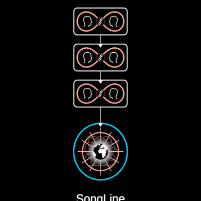

# SongLine



A DreamNode's chain of provenance. "Each dream node will track its journey
through the interbrain, at every step clipping the part of the
conversation where the knowledge was transmitted. The resulting chain of
provenance we might refer to as a song line" (InterBrain film,
33:21–33:43). The film shows the node hopping through the liminal web,
dropping a clip at each hop (f10036–f10086); the clips then straighten
into one column above it, joined by arrows down into the node (f10096–
f10186, labelled "SongLine").

Each clip is a rounded white box holding a digital campfire conversation:
two heads in profile facing each other, each in a lobe of a red infinity
loop, and where the loop crosses a small dark-red circle with the Vision in
it, white (f10141, zoomed). Composed: the heads are `Figure` (the bust
side-on, seated as `SandTalk` seats them), the mark is `Vision`, the node is
`DreamNode` (default face a DreamTalk symbol); the box and the loop (a
lemniscate of Bernoulli) are its own line work. `Clip` is exported for a
composer that needs a single clip.

```ts
line = new SongLine({ size: 167, count: 3 })     // f10141: ring 80 px
```

**Params**: `size` (S, the node's ring radius — every measure derives from
it: box 1.99 × 0.95 S, pitch 1.275 S, the lowest box 2.05 S above the node,
loop 0.869 × 0.338 S, mark 0.156 S), `count` (clips), `tint`, `loopTint`
(RED), `stroke`; construction: `face` (the node's face).

**State**: `grow` 0..1 — the clips arrive one by one, oldest (top) first,
each with the arrow carrying it down toward the node.

**Proven by**: `docs/reports/interbrain/songline-compare.png` (f10141),
`test/ib-songline.test.ts`, `?scene=ib-songline`.

**Residual**: the film's loop glows (a soft red halo) and is a deeper red
than the palette RED; the heads are the bust's profile, which carries a
little shoulder the film's head-and-neck does not.
