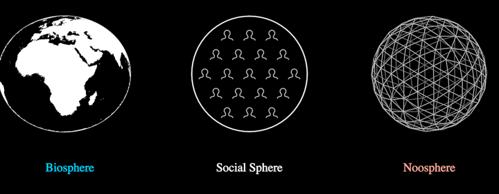

# Spheres



The Earth, a circle of little people, the geodesic lattice: in a row with
their names beneath, or stacked with the arrows of influence and leverage.

**The concept: the three realms of engineering** (7:00–8:20): "the first
gives rise to our infrastructure, the second forms our social structure, and
the third influences our superstructure, the stories we tell and live by",
named the biosphere, the social sphere and the noosphere. The noosphere
informs the social structures, which determine the infrastructure: the
ORDER OF INFLUENCE flows down; the LADDER OF LEVERAGE climbs up, and the war
machine climbs it (8:20). In ch8 the healing trickles down the same ladder
(f12451 → f12496).

**Composed, never redrawn**: the biosphere is `FragmentedEarth` (bare when
plain) and, healed, `DreamTalkSymbol`; the social sphere's people are
`Figure` busts and its bolts `Conflict`; the noosphere is `Noosphere`; the
icon rows are `Icons` props. Only the social sphere's circle, triangle grid
and petals are this holon's own lines.

```ts
spheres = new Spheres({ labels: 3 })                    // f2236
spheres = new Spheres({ stack: 1, arrows: 1 })          // f2416, f2506
spheres = new Spheres({ stack: 1, arrows: 1, fragmented: 1, healed: 1 })  // f12496
```

**Params** (the unit `size` is the row's sphere radius, 125 px; origin the
frame's centre)
- `stack` (0): the row ↔ the stack (noosphere largest on top).
- `labels` (3): 0 none, 1 Physical / Social / Narrative Engineering,
  2 Infra- / Social- / Super-structure, 3 Biosphere / Social Sphere /
  Noosphere; neighbouring namings cross-fade. Row only.
- `icons` (0): the three icon rows over the spheres, in turn (f2111–f2161).
- `arrows` (0): ½ the order of influence (red, down), 1 the ladder of
  leverage too (blue, up), each with its words.
- `fragmented` (0): the wounded realms of ch8 (blue flower noosphere, the
  social sphere a blue square of boxed people and bolts, the Earth ringed
  and struck).
- `healed` (0): the healing, top down: noosphere red, then the social sphere
  a red circle of petals, then the radiant Earth.
All six are walkable axes.

**Residuals**: the film's ch8 stack is a little smaller than ch2's (noosphere
143 vs 166 px; a scene scale, not a state); the wounded noosphere's red seed
at its heart (f12451) is not drawn; the noosphere's frequency switches 4 → 7
mid-bloom (the film cuts there); the social sphere's triangle grid is
clipped to the circle where the film fades it toward the square's corners,
and its busts sit on one lattice in every state (the film's wounded busts are
a little larger).

**Proven by** `test/ib-spheres.test.ts` (19 seats 3-4-5-4-3, the grid passes
between them, circle ↔ square outline, row/stack places, healing order and
endpoints, the axes). Standalone scene `ib-spheres`; comparison against
f2161, f2236, f2416, f12451, f12496: `docs/reports/interbrain/spheres-compare.png`.
