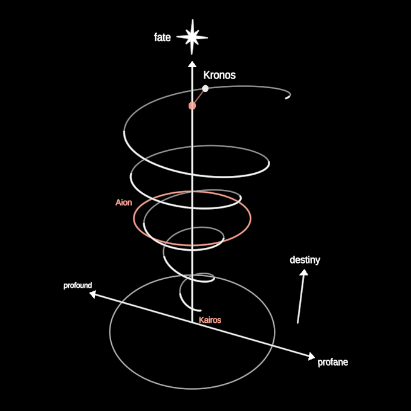

# TimeSpiral

The three forms of time as one figure. Kronos, linear time, is the vertical
arrow and the flat plane it stands on. Aion, cyclic time, is a circle: a turn
that comes round again. Together they make the spiral: a helix winding up the
vertical, narrow at the bottom and widening as it rises, each turn one aeon,
one hero's journey, one of them held by a red ring. Kairos, the quality of the
moment, is the spiral's unchanging centre, the axis itself. Past, present and
future rhyme on it rather than mirror: successive turns are similar, never
identical.

Above, a star: fate as a pulling force, the arrow of Kronos pointing at it.
From below, an arrow: destiny as a pushing force. The base line runs from the
profound world (left, where Kairos moments come more readily) to the profane
world (right, the depth of integration).

**Real 3D.** The helix is a real helix in the symbol's own frame, leaned
toward the eye; the camera can orbit it. Its near half is drawn bright and
its far half dim, split live against the eye. The base is a horizontal plane
(its rim) with the line across it; the star, the dots and the words turn to
face the eye.

**The forms** (`time`): 0 Kronos, the helix collapsed onto the axis, a
straight line; 1 Aion, every turn at one height and one radius, a circle (the
red ring round it); 2 the spiral, the circle stretched up and down the axis
into the widening helix.

**Rhyme** (`rhyme`): 0 mirror, every turn a scaled copy of the last; 1 rhyme,
each turn its own. The variation is deterministic: turn k is a slight ellipse,
slightly tilted, both oriented at k times the golden angle, so every turn is
kin to its neighbours and none ever repeats. It only takes effect as the
spiral opens; the pure line and the pure circle have nothing to rhyme.

**The present moment** runs on the symbol's clock (`now`, seconds): a white
point travels the curve (up the line, round the circle, up the spiral), and
its Kairos, a red point joined to it by the radius, is its projection onto
the centre.

**Params**: `height` (the axis's half-length, the one size), `time` 0 kronos ·
1 aion · 2 spiral, `rhyme` 0 mirror … 1 rhyme, `labels` (the words'
presence), `now` (a clock).

**Axes**: `time` (kronos · aion · spiral), `rhyme` (mirror · rhyme); no fixed
keys (the player assigns digits; rekeyable). `now` is a clock, so the moment
keeps travelling in free play. A whole that drives a param makes that axis
its own.

**Construction** (H = `height`, the axis centre at the origin): the base plane
at y = −H, its rim radius 0.72H; the helix 5 turns from −0.86H to 0.86H, its
radius 0.07H → 0.62H linearly with the turn; Aion's circle at y = 0, radius
0.345H; the ring round the third turn at 1.32 × its radius; the star at 1.24H.
Pure: `spiralPoint(s, time, rhyme)`.

**Parts**: primitives only (Lines, two Polylines for the curve's near and far
halves, filled Circles, Text).

`?scene=time-spiral` draws the figure, folds it to Kronos and Aion and back,
and lets its turns mirror and rhyme; `?scene=time-spiral&play=free` walks it.
