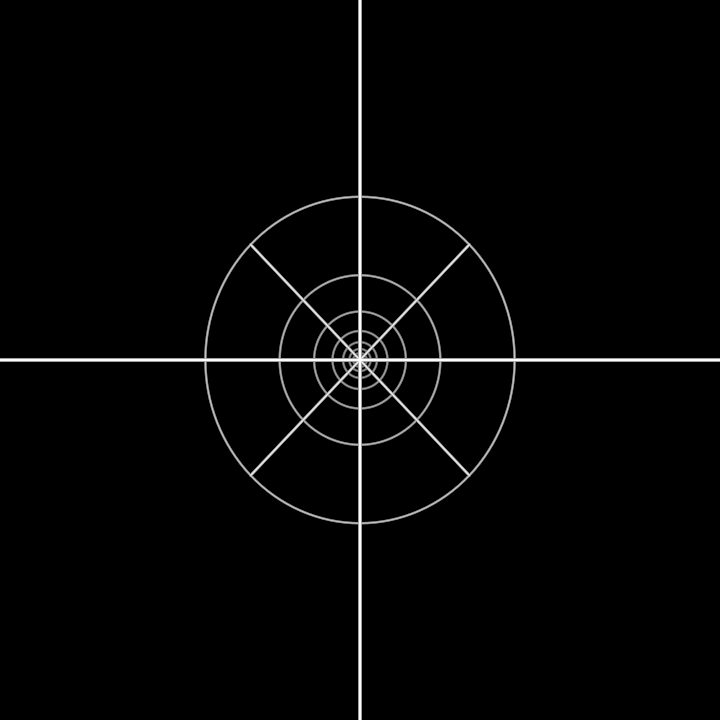

# Totality

Horizontality, verticality and totality. A cross: the horizontal axis (x)
and the vertical axis (y), both white. Their intersection is totality, which
is orthogonal to both. It is the third axis (z, red), the line one looks
through the cross along. Verticality ends in totality, since the vertical
meets the horizontal there, but it does not lead there. Totality is not
further up. It lies in the other direction.

**Through** (`through`). At 0 the cross is face-on and flat, just x and y.
As `through` rises, the figure turns to show what the flat cross hid: the
third axis growing back from the intersection, and strung down it the icons,
the cross repeating smaller and smaller as it recedes. Then the figure turns
back face-on and comes toward the eye until the eye stands in the
intersection and looks down the line. From there the icons form a
self-similar tunnel. Each icon is the cross inside its ring (the circle
through its four tips), and each is turned an eighth from the one before. The
arms of the + and the × alternate, and the rings nest toward one vanishing
point.

The tunnel is finite (14 icons) but reads as endless. On the symbol's own
clock (`fall`) every icon slides one level deeper every 4 s, turning its
eighth as it goes, and a new icon opens out of the cross. The picture then
repeats exactly, so the flow loops without a seam.

**The plane** (`plane`), a second reading: horizontality as a plane and
verticality as the line normal to it. The horizontal bar is the plane seen
edge-on. It opens into a disc whose rim has the arm's radius, the figure
leans toward the eye, and the vertical stands on the disc's centre, normal to
it. Both `through` and `plane` can be walked only from the flat cross, so
only one third dimension is shown at a time.

**Construction** (a = `size`, the arm): icon k (continuous: k plus the
clock's fraction) is the cross scaled by q^k about the vanishing point
(0, 0, −L), where L = 3a. It stands at z = −L(1 − q^k) with arm a·q^k and is
turned k·π/4 about z, with q = 0.64. One similarity maps the tunnel onto
itself. Each icon is a fixed unit cross and ring carried by its transform
alone, so no geometry is rebuilt per frame. The approach brings the
intersection 62% of the way to the eye.

**Params**: `size` (the arm; the one size), `through` 0 cross … 1 through,
`plane` 0 bar … 1 plane, `fall` (a clock).

**Axes**: `through` (`t`: cross · through; Esc goes back to the cross),
`plane` (`p`: bar · plane); `fall` is a clock, so it keeps running in free
play. A whole that drives an axis's param makes that axis its own, and any key
can be rekeyed.

**Parts**: primitives (Lines and stroked Circles).

`?scene=totality` draws the cross, opens and closes the plane, then looks
through the intersection down the third axis and comes back out;
`?scene=totality&play=free` walks it.
