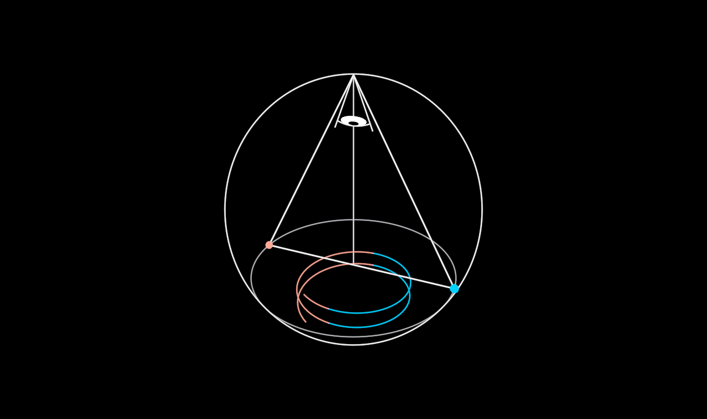

# Triad

A triangle of two naive opposites and the one without an opposite. At the
base, two poles that mirror each other and act as if they were enemies: the
hot one (red: spirit fleeing matter, light, lowercase good) and the cold one
(blue: matter devouring spirit, rigid, shadow, lowercase evil). Under them,
lowercase life and death in a back-and-forth dance. At the apex, capital-L
Life, or Reality, which has no opposite: on the vertical a thing is either
real or not there at all. The base plane is where things come in degrees.

**Real 3D.** In a flat drawing, horizontal and vertical can be swapped. In
space, a horizontal plane and the vertical line normal to it cannot. So the
flat drawing is treated as a 3D figure seen exactly edge-on. `unfold` opens
the third dimension:

- the base edge opens into the horizontal plane's rim, a circle with the base
  as its diameter and the two poles at opposite ends;
- the coil under the base opens into a helix turning round the vertical axis
  under the plane, red on the hot pole's side and blue on the cold pole's;
- the vertical line rises from the plane's centre to the apex.

The figure leans toward the eye as it unfolds, and the camera can orbit it.

**Two readings** (`reading`). At 0, the apex is Life itself, shown as a
white point. At 1, the triangle is read as the ego: an `Eye` opens at the
apex, gazing down into the triangle, for the figure that holds good and evil
in one. Life is then the whole that holds everything, drawn as the
triangle's circumscribed sphere. The sphere meets the base plane exactly in
the plane's rim, and the coil fits inside it.

**The dance** runs on the symbol's own clock (`dance`, seconds). The helix
turns, and life and death keep trading places through it, each staying on its
pole's side.

**Perspectives** (`view`, a camera reading). The same figure is seen through
three eyes, and the camera goes to each:

- **below**: standing on the plane in lowercase life, looking up. The
  triangle towers overhead, and the eye at its apex turns its face down to the
  one looking and looms twice its size. Seen from inside, the sphere has no
  outline and fades.
- **side**: low among the coil, between the poles, the gaze swinging left and
  right along the base with the dance. Only one pole is seen at a time, large
  and close, with strands of red and blue passing edge-on. This is the
  relative eye, and to it the figure looks incoherent.
- **above**: over the apex, from Life, looking straight down the vertical.
  From here the same figure is an ordered creation. The rim and the sphere's
  outline are concentric circles, the base is a diameter with the poles at its
  ends, and the helix is a two-turn spiral, red on the hot pole's side and blue
  on the cold pole's, around the centre the vertical stands on.

`rig(observer, home?)` gives the symbol the scene's camera. From then on the
camera is bound to its home pose (the observer's own pose, or `home`) and is
blended toward each eye by three weights, `below`, `side` and `above`. The
blend works in the observer's own terms: the focus, the orbit angles, the
distance (logarithmically) and the lens. A roll keeps the figure's plane of
symmetry upright on screen. With every weight at 0 the camera is exactly the
home pose, so a scene that never walks `view` sees what it always saw. The
viewer's free orbit stays a layer on top. The eyes are listed in `VIEWS`, in
units of ρ in the figure's own frame.

**Params**: `radius` (the triangle's circumradius, which is also the sphere's
radius; the one size), `unfold` 0 drawn … 1 3D, `reading` 0 apex … 1 whole,
`dance` (a clock), and `below` / `side` / `above` (the view weights, 0 … 1).

**Axes**: `unfold` (`u`: drawn · 3D), `reading` (`w`: apex · whole), and,
once rigged and unfolded, `view` (`v`: orbit · below · side · above; Esc goes
back to orbit). `dance` is a clock, so it keeps running in free play. A whole
that drives `unfold` or `reading` (or the view weights) makes that axis its
own, and any key can be rekeyed.

**Construction** (ρ = `radius`, the sphere's centre at the origin): the
triangle is equilateral, with its apex at (0, ρ, 0) and its poles at
(∓ρ√3/2, −ρ/2, 0). The plane is y = −ρ/2, with a rim of radius ρ√3/2, which
lies on the sphere. The helix has radius ρ/2, runs 2 turns from −0.58ρ to
−0.84ρ, and turns once every 9 s.

**Parts**: `Eye` (the sovereign symbol, its lids driven by the reading) and
primitives (Lines, filled Circles that turn to face the eye).

`?scene=triad` draws the figure, unfolds it, turns the reading, then takes
the camera below, to the side and above, and home again;
`?scene=triad&play=free` walks it.
