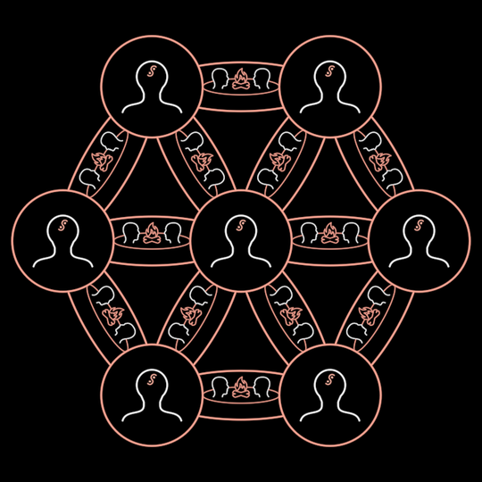

# Tribe

People bound into one body. Ancient: seven liminal minds in red circles on
a hexagon, a campfire conversation on every edge. Modern: the blue "boxed
web" of narrative-held minds in squares, joined by bare lines.

**The concept.** The ancient tribe is the Dunbar-scale community where
freedom of speech round the campfire yields emergent order (InterBrain film,
20:14–21:00; f6091, f6106, f6151). Tribes gather into tribes of tribes
(f6286, f6376). The modern web is "our contemporary communication media …
tuned to amplify narrative engineering" (17:48; f5221, f5341), and it grows
huge (f6736, f6826). The film walks one into the other on its timeline
(f6496: ancient → book → radio tower → modern), so the era is one number.

**Composed, never redrawn.** Each person is `Mind` (liminal when ancient,
domesticated when modern; its own frame off). Each edge's campfire is a
`SandTalk` (no sand symbol, a flatter ring). The narrative box is
`FoldableCube`. The node frame (circle ↔ square), its black body, the edge
band and the box's ring are Tribe's own lines.

**Params** (in units of D = `size`, the distance between neighbouring
minds; the table is `TRIBE`)
- `size`: D. Ancient circle radius 0.285·D, modern square half-side
  0.266·D. Busts 0.286·D (ancient) growing to 0.356·D (modern). Edge band
  0.455·D by 0.137·D. Campfire ring half-width 0.216·D.
- `modern` 0..1: ancient to modern. It scrubs: the minds turn domesticated,
  circles square, red turns blue, the bands narrow to a line and their
  SandTalks fade.
- `boxed` 0..1: the narrative box (a white cube in a blue ring) over every
  head but the middle one (f5221). Seen only as far as `modern`.
- `rings`: hexagonal rings of minds round the middle one. 1 is the tribe of
  seven (12 edges), 3 is f6736's web (37 minds, rows 4-5-6-7-6-5-4).
- `depth`: tribes of tribes. At depth k, six more tribes stand round the
  centre at 2.9^k·D, the ring turned 30° (f6286).
- `dim`: how bright the outer tribes are (0.29, measured on f6286). They are
  dimmed by a black veil, not faded, so their minds still hide their edges.
- `stroke`: pen width (2.6 px at the film's D = 266 px; thinner for small D).

**Abilities**: walkable (`stateSpace`), with an `era` axis (ancient ↔ modern)
and a `boxed` axis (bare ↔ boxed). Create draws the minds ring by ring, then
the edges and their campfires.

**Residuals**
- The resonance ripples (cyan, f6106/f6286) are the `Resonance` holon's job
  (wave B), not drawn here.
- f6736 leaves out the middle horizontal edge of the top and bottom rows.
  Ours is the full triangular lattice, because the frame gives no rule for
  that gap.
- The cubes (Mind's and the box's) are true 3D `FoldableCube`s seen by the
  scene camera, so off-axis nodes show a side. The film's narrative icon is
  a flat one-point drawing (MolochEye's pupil). A popped-out `Narrative`
  holon would fix both at once.
- The film's lines glow and its modern blue is deeper than `BLUE`.

**Proven by** `test/ib-tribe.test.ts`. Standalone scenes `?scene=ib-tribe`
(ancient → modern → boxed), `ib-tribe-web` (rings 3, f6736), `ib-tribes`
(depth 1, f6286). Compare: `docs/reports/interbrain/tribe-compare.png`
(f6091, f5221, f6286, f6736).
