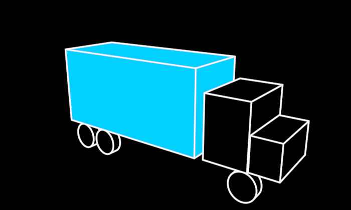

# Truck



A truck, platonic: a box trailer of blue cargo, a cab, a hood, six wheels.
It is drawn the way the 2021 vocabulary draws everything — white lines on
black and one fill colour — but its lines are its **visible 3D edges**,
recomputed for wherever the camera is: hidden edges are removed, the
wheels' contour lines sit where the view ray grazes them, and the cab
hides the cargo behind it. Turn the camera and the lines stay where they
belong in space; they were never drawn on a plane.

```ts
truck = new Truck({ observer: this.observer })   // seen as the scene's camera sees it
```

Pass the Dream's `observer`, or the truck is drawn as the default camera
(straight down −z) would see it.

**Promoted params**: `cargo` (BLUE, the trailer's fill), `body` (BLACK —
cab, hood and wheels are solid on the black ground), plus the Stroke set
(`tint` is the line colour, `stroke`, `opacity`, and `fillOpacity`,
default 1: how much of the fills shows — they dim toward the ground
rather than turning translucent, so the cab stays solid while it fades).

**Made of**: `src/parts/soliddrawing.ts` (`SolidDrawing` — any holon that
states its solids gets this drawing and `worldCurves()`), over
`src/geometry/hiddenline.ts` (boxes and capped cylinders, CPU hidden-line
removal, painter-ordered fills).

**Why it exists**: the dot→truck morph (`/demo/?scene=morph-dot-truck`,
vocabulary/Morph `MorphCurves`) — a blue particle in a flow becomes the
truck it stands for, and back. Its `worldCurves()` is what the morph lands
on. 640 long (+x, cab forward), 268 tall, 180 wide, origin at the middle
of its bounding box.
