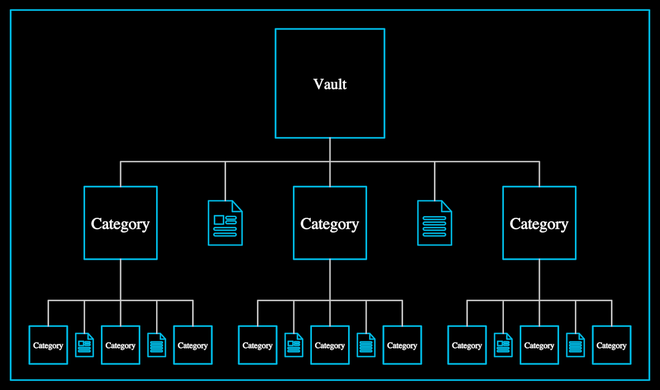

# Vault



A blue frame; at its head a "Vault" box; beneath it, on a white bus,
Category · page · Category · page · Category; under every Category the same
five again, smaller, and so on.

**The concept: knowledge as MANAGED.** "Represented in the fundamental unit
of written documents and structured in a hierarchy of categories"
(27:24–27:36): the way a second brain keeps what it knows, the picture the
InterBrain answers (f8281, f8296, f8326; the recap f12346).

**The drawing**, measured off f8326 in px (frame width 1064.5 px is the unit,
`size`; origin the frame's centre): Vault box 181.5 px; level 1 Categories
121 px, 174.5 px apart; level 2 63 px, 60.25 px apart; pages 0.61 of their
level's box, alternating the Icons `article` and `document`.

```ts
vault = new Vault()                 // f8326, where the film has it
vault = new Vault({ grow: 0.5 })    // the Vault and its first level (f8281)
```

**Params**
- `size`: the frame's width.
- `depth` (2, structural): levels below the Vault. Deeper levels continue
  level 2's proportions, tightened where parents are crowded, never
  overlapping.
- `grow` (1): 0 the Vault alone … 1 every level, top down; each level drops
  its lines, then its boxes and pages, then its words. Walkable.
- `tint` (blue), `linkTint` (light grey), `textTint` (white), `stroke`, `linkStroke`.

**Abilities**: Create runs the cascade up to where `grow` stands.

**Residual**: our BLUE is the palette's, a touch brighter than the film's
box blue; the film's pages carry a faint blue wash.

**Proven by** `test/ib-vault.test.ts` (counts per level, the pattern, even
spacing, page proportions, deeper levels clear, `grow` endpoints).
Standalone scene `ib-vault`; comparison `docs/reports/interbrain/vault-compare.png`.
