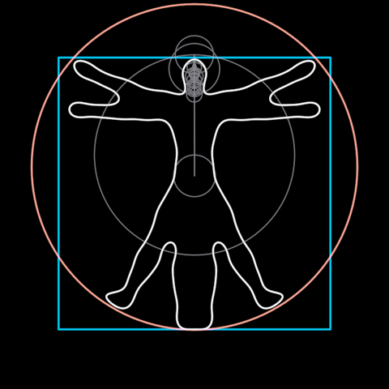

# Vitruvian

Da Vinci's man inside his red circle and blue square, drawn by Fourier
epicycles: a chain of spinning circles whose pen traces the figure. Used in
the Web3 video's shot 12 and in its standalone scene.

**Faces**: `?scene=vitruvian` (the face above is its finished figure).

## What it is

`circle` and `square` are Da Vinci's frame, measured from the reference
frame (radius 314, centred 53 above the figure; side 524). `pen` is the
epicycle machine (a `FourierTrace`, `penTerms` 130), and its `turn` draws
the man. With `figureTerms` > 0, `figure` holds the finished outline under
the pen. It is the same series, so the pen and the figure never disagree.
`startAt` rolls where the closed path begins: 0 is the bottom centre, and
`START_AT_HEAD` makes the pen finish on the crown.

The outline (`path.ts`) is a trace of the video's pixels, not a vector
original. Its header gives the method.

## Promoted params

`frameStroke`, `circleOpacity`, `squareOpacity`, `figureStroke`; the
construction-time `penTerms`, `figureTerms` and `startAt`. The parts stay
addressable (`pen.turn`, `figure.ink`) for scenes that choreograph them.
