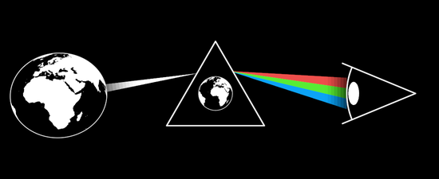

# Worldview



The lens we look through: the Earth on the left, a white beam of light into
a prism in the middle, a rainbow out of the prism into an eye on the right.

"We can never interact with reality directly … we condense it into a
representation we can navigate, a worldview … we can only ever look
through this lens, never directly at it" (InterBrain film, 10:56–11:39).
The direct path from the world to the eye is crossed out; the prism stands
between them, and what reaches the eye is the spectrum the lens makes of
the light, in a feedback loop. Then the lens is engineered: the world
fragmented, a narrative cube in the prism, the spectrum smeared, a puppeteer
on the strings, doubt at the eye (11:44); many puppeteers pulling at once
(multipolar, 15:00); and healed — the strings cut, the eye looks AT the
lens instead of through it (25:07), the world a radiant DreamTalk symbol
through a flower-of-life prism (39:20).

Not vocabulary/Lens (a magnifier): same word, different symbol.

```ts
const view = new Worldview({ lens: "earth", loop: 1 })            // f3391
const manipulated = new Worldview({ source: "fragmented", lens: "cube", distortion: 1, strings: 1 }) // f3541
this.play(view.pullers.to(3))                                     // f4561
this.play(together(view.reverse.to(1), view.lens.to(LENS.lattice))) // f7606
```

**States** — each one number, so it scrubs and the automaton walks it:

| param | 0 → 1 | frames |
|---|---|---|
| `light` | no light → the beam (and the spectrum) | f3256 → f3331 |
| `prism` | light straight to the eye → into the prism, the spectrum out of it | f3331 → f3376 |
| `direct` | the bracket arrows world → eye and back draw on | f3301 |
| `crossed` | both crossed out ✗, a grey "?" | f3331 |
| `loop` | the feedback loop round the lens | f3391 |
| `distortion` | clean spectrum → smeared pastel ribbon; a "?" rises at the eye | f3541 |
| `strings` | the puppeteer appears and its strings drop onto the prism | f3541 |
| `pullers` | 1..5 hands; from 2 the beams split, the ribbon shreds, bolts strike between the hands, the "?" multiply | f4561 |
| `reverse` | the light goes; an arrow runs from the eye to the prism | f7606 |
| `lens` | index, cross-fading: 0 empty · 1 earth · 2 noosphere (or `lensFace`) · 3 cube · 4 lattice · 5 flower | f3361, f3376, f3451, f3541, f7681, f11806 |
| `source` | index, cross-fading: 0 earth · 1 fragmented · 2 radiant · 3 `sourceFace` | f3391, f3541, f11806, f7726 |

`lens` and `source` take their names at construction. Keys in free play:
`z` distortion, `j` strings, `u` pullers, `v` reverse, `k` lens, `e` source.

**Construction** (f3391 at the default eye's 0.48 px/unit; origin the
prism's bounding-box centre): the prism equilateral, side 510; the globe at
(−802, −61), r 221; the eye's apex at (1044, −52) gazing −x, scale 1.793.
The beam enters the left side 0.62 up and leaves the globe 42 wide, dark at
the world and full from a third of the way; the spectrum leaves the right
side 0.64 up and fans to ±82 about the eye's axis at its eyeball arc, red /
green / blue (sampled), darkening over its last fifth. Exported: `WV`,
`prismCorners`, `prismSide`, `bowOffset`, `hatch`, `clipCircle`.

**Composes** (imports, never redraws): vocabulary/FragmentedEarth (the bare
Earth is it with `decoration` 0), vocabulary/DreamTalkSymbol (the radiant
source), vocabulary/Eye (video-01's, with the film's slim iris and no
pupil), vocabulary/Puppeteer (the hands), vocabulary/Noosphere (lens 2),
vocabulary/Conflict (between the hands), vocabulary/Earth (the world in the
lens).

**Not yet**: the eye opens to 22.5° — the film's 29.2° needs Eye's
`opening` (a completion, 0..1) to go past 1. The narrative cube is drawn as
two squares and four connectors (MolochEye's pupil-cube construction, here
at the film's back/front 0.66) — a `Narrative` pop-out would own it. The
scissors that cut the strings (f7561) and the vertical divider of f3451 are
not drawn. Globes left of centre read slightly oval (perspective; the film
is orthographic). The film's multipolar prism shows the sparse cube-state
grid without its cube; the demo shows the lattice.

**Proven by**: `docs/reports/interbrain/worldview-compare.png` (f3391,
f3541, f4561, f7606, f11806 against `?scene=ib-worldview`),
`test/ib-worldview.test.ts`.
